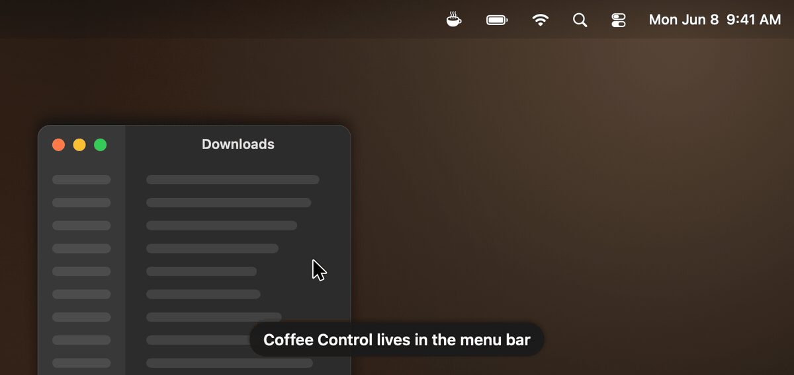
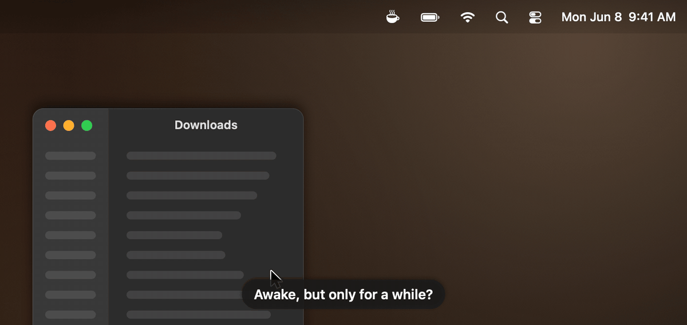
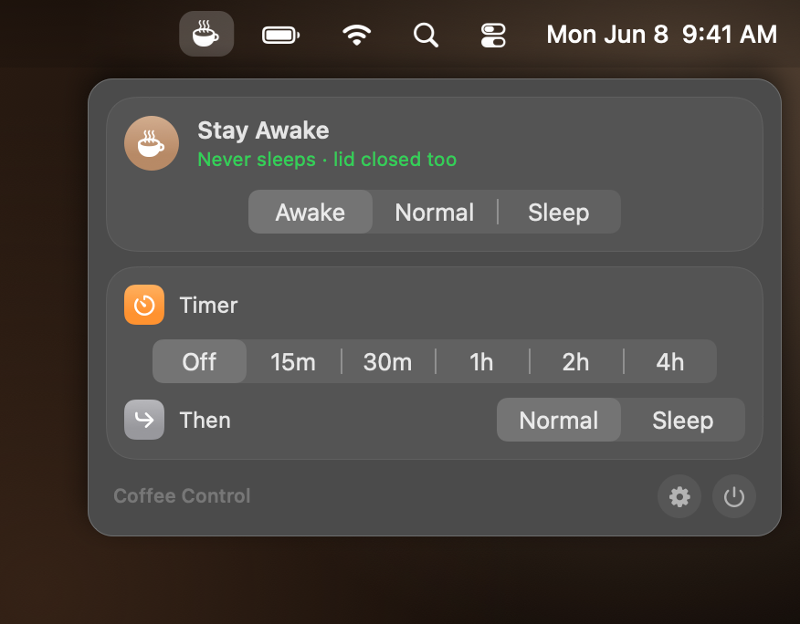
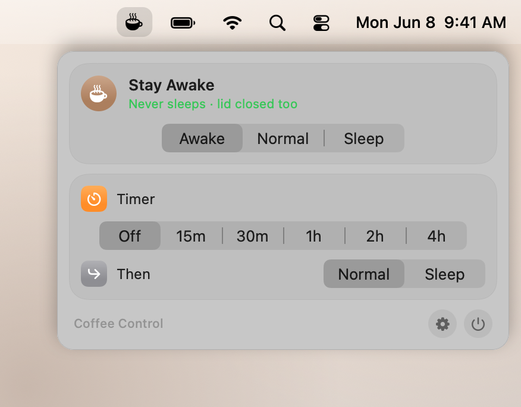
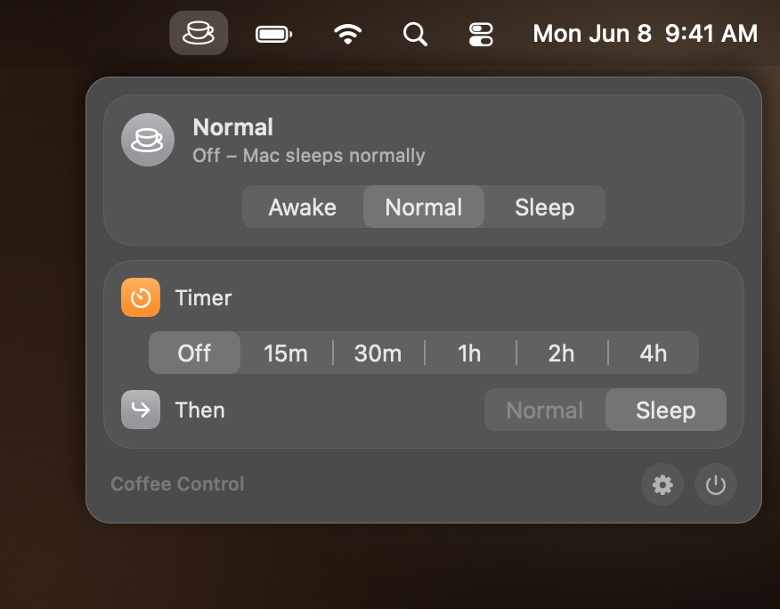
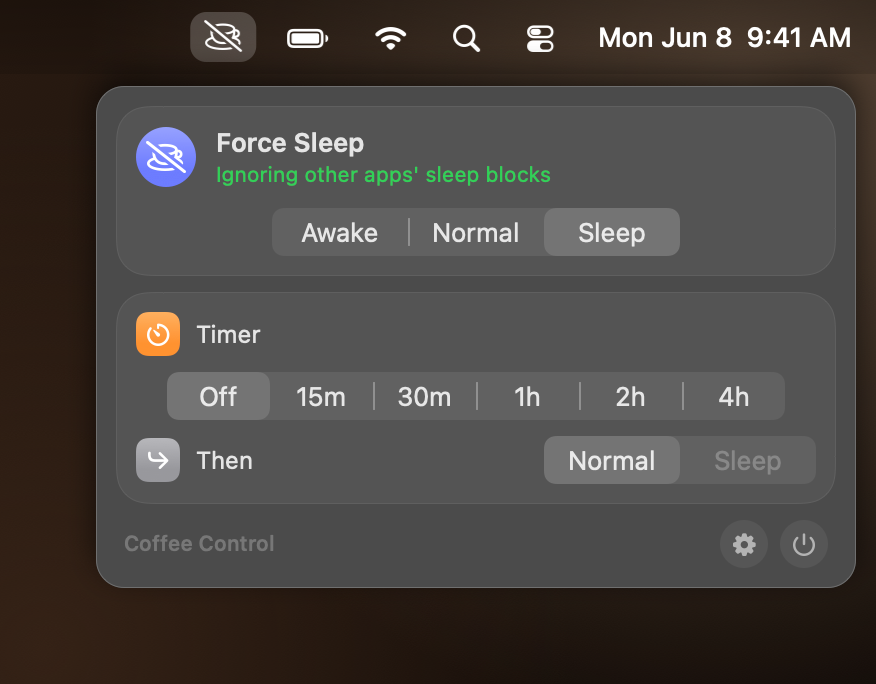
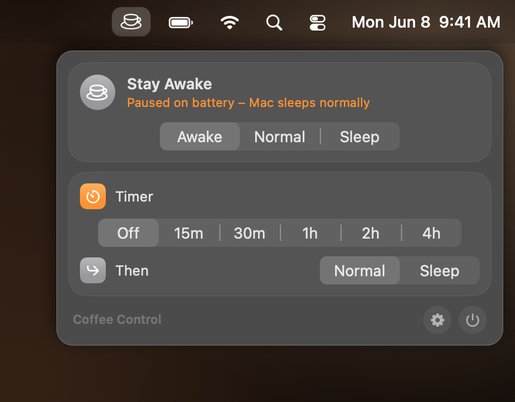
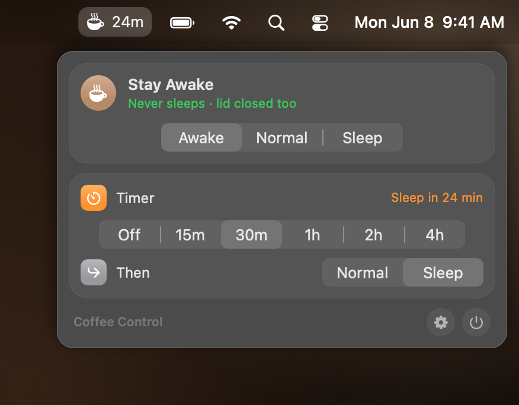
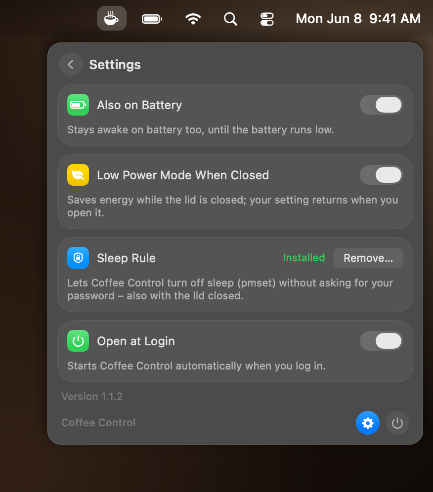

<p align="center">
  
</p>

<h1 align="center">Coffee Control</h1>

<p align="center">A menu bar app that keeps your Mac awake, even with the lid closed, lets it sleep normally, or forces it to sleep despite other apps.</p>

<p align="center">
  <a href="#requirements"></a>
  <a href="docs/DEVELOPMENT.md"></a>
  <a href="LICENSE"></a>
  <a href="#ai-assisted-development"></a>
</p>

> [!NOTE]
> This app was developed with AI assistance. See [AI-assisted development](#ai-assisted-development).

## In action

### Switching modes

<p align="center">
  
</p>

Switch between Awake, Normal and Sleep with one click. The menu bar icon and the status line follow the mode immediately.

### Timer

<p align="center">
  
</p>

Limit the current mode: after 15 minutes to 4 hours the Mac goes back to Normal or straight to Sleep. The menu bar shows the minutes left.

<sub>The animations are rendered by the app itself from invented demo data; nothing on your Mac is recorded.</sub>

## Features

- **Three modes**: **Awake**, **Normal** and **Sleep**, switched with one click in the menu.
- **Awake**: the Mac never sleeps, not even with the lid closed. The status line shows what the system really reports and the app reverts it if something else resets the setting.
- **Timer**: keep the current mode for 15 minutes to 4 hours, then switch to **Normal** or **Sleep**. The minutes left appear next to the menu bar icon; switching the mode by hand or quitting cancels the timer.
- **Sleep (force sleep)**: the Mac sleeps as if nobody had started `caffeinate`, regardless of which app holds a sleep block (video, screen sharing, `caffeinate -s`).
- **Closed-lid comfort**: optional Low Power Mode while the lid is closed (your previous power modes are restored on opening) and the built-in display is switched off.
- **Also on Battery** option: when off, the app pauses on battery and the Mac sleeps normally.
- **Safe**: quitting restores everything; Normal mode changes nothing on the system.

## Screenshots

<p align="center">
  
  
</p>

<table>
  <tr>
    <td align="center"><br>Normal: the Mac sleeps as usual</td>
    <td align="center"><br>Force Sleep: ignores other apps' sleep blocks</td>
  </tr>
  <tr>
    <td align="center"><br>Paused on battery</td>
    <td align="center"><br>Timer: Sleep in 24 minutes</td>
  </tr>
  <tr>
    <td align="center"><br>Settings</td>
    <td></td>
  </tr>
</table>

## Requirements

- macOS 26 or later on Apple silicon

## Installation

1. Download `CoffeeControl-<version>.zip` from the [latest release](../../releases/latest) and unzip it.
2. Move **CoffeeControl.app** to `/Applications`.
3. Open it. The app is free and ad-hoc signed, not notarized by Apple, so macOS blocks the first launch:
   open **System Settings → Privacy & Security**, scroll down and click **Open Anyway**.
   Alternatively, in Terminal: `xattr -dr com.apple.quarantine /Applications/CoffeeControl.app`
4. For the closed-lid feature and force sleep, click **Set Up…** once in the menu (see [Permissions and privacy](#permissions-and-privacy)).

The app starts at login by default; switch this off under Settings (gear icon) → **Open at Login**.
To uninstall, remove the sleep rule under Settings → **Sleep Rule** → **Remove…** if you installed it, quit the app from the menu and move it to the Trash.

## Usage

- Click the menu bar item and pick a mode: **Awake**, **Normal** or **Sleep**.
- **Timer**: pick a duration and what follows (**Then Normal** or **Sleep**); **Off** cancels it.
- Settings (gear icon): **Also on Battery**, **Low Power Mode When Closed**, the sleep rule and **Open at Login**.
- Quit with the power button in the menu footer; everything the app changed is restored.

Note: while Awake, a closed MacBook in a bag gets warm and drains its battery. The protections of macOS for low battery and overheating still apply.

## Build from source

```sh
brew install xcodegen
git clone https://github.com/ape97/CoffeeControl.git && cd CoffeeControl
./scripts/check.sh    # build + snapshots + self-test -> RESULT: GREEN
./scripts/deploy.sh   # check, install to /Applications, restart
```

No Apple developer account is needed. Project layout, scripts, signing, screenshots and releases are described in
[docs/DEVELOPMENT.md](docs/DEVELOPMENT.md).

## Permissions and privacy

Coffee Control asks for no privacy permissions (no Accessibility, no Full Disk Access, no location). It does need
administrator rights for one optional step:

- **Sleep rule (optional, one-time, administrator password).** Closing the lid without sleeping, and forcing sleep, require
  changing system power settings with `pmset`, which only root may do. Clicking **Set Up…** (or Settings → **Sleep Rule** →
  **Install…**) shows the standard macOS password dialog and installs `/etc/sudoers.d/coffeecontrol`. This file allows your
  user to run exactly these commands without a password, and nothing else:
  `pmset -a disablesleep 0|1` and `pmset -c|-b powermode 0|1|2`. The syntax is checked with `visudo` before the file is
  installed. **Remove…** deletes it again. Without the rule, Awake still works with the lid open, but not with it closed,
  and force sleep cannot reset a foreign `disablesleep` setting.
- **No background service.** The app is not a daemon and installs no helper tool. The rule only takes effect when the app runs `sudo -n pmset …`.
- **Other processes.** For the charger case, Sleep mode ends `caffeinate` processes that block system sleep (only `caffeinate` itself, never the program that started it). The app runs `pmset sleepnow` and `pmset displaysleepnow`, which need no special rights.

Everything stays on your Mac: no network access, no telemetry. The only stored data are your settings in the app's user defaults.

## AI-assisted development

Coffee Control was built with the help of an AI coding assistant: code, comments, documentation and the screenshot
pipeline were written in collaboration with AI. Every change is built and checked with `scripts/check.sh`
(warning-free build, snapshots, self-test, performance test) and the app is in daily use on the maintainer's Mac.
Issues and pull requests are welcome.

## License

MIT, see [LICENSE](LICENSE).
